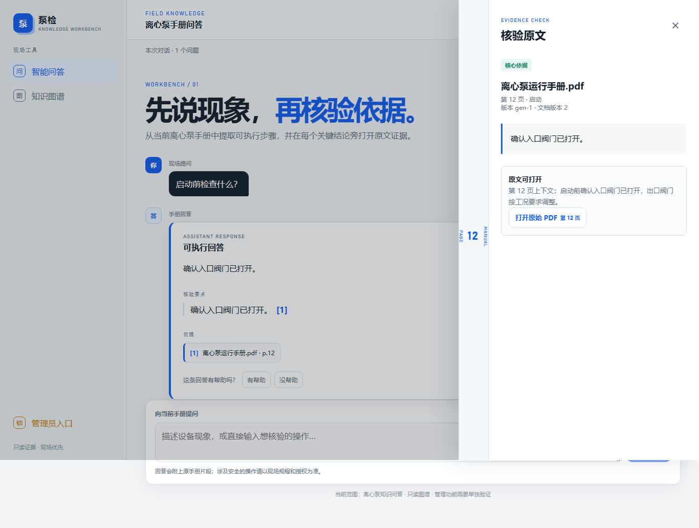
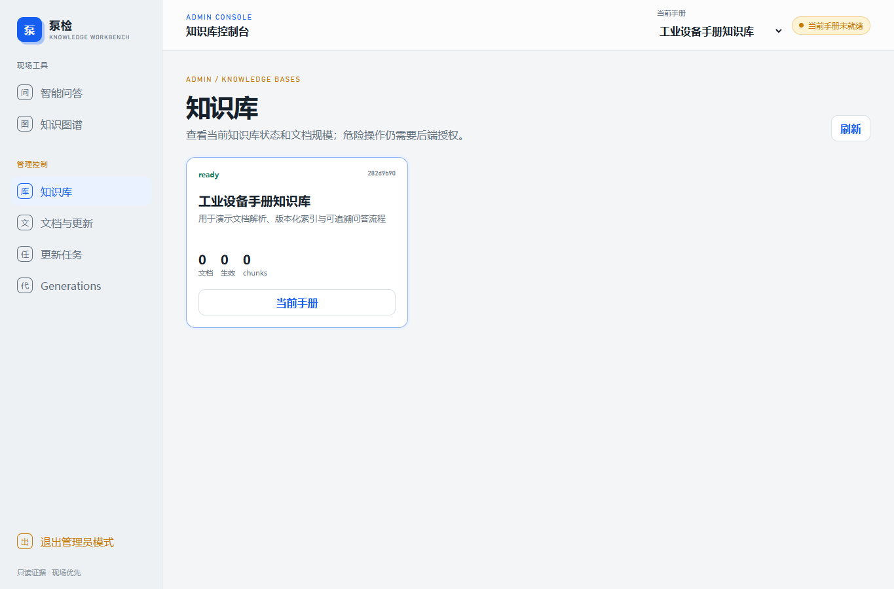
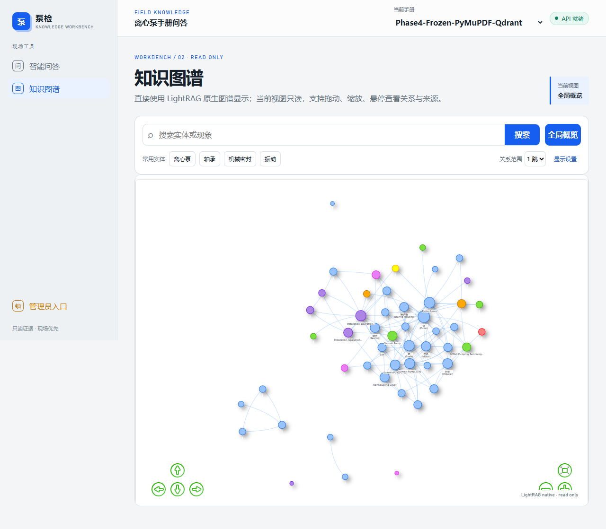
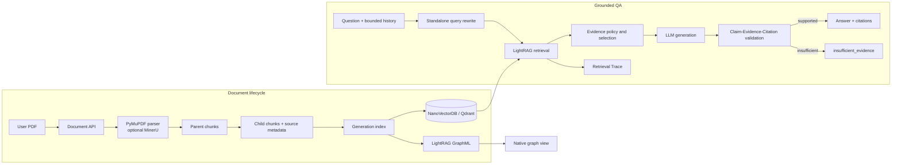

# Industrial LightRAG QA

### 面向工业设备手册的可追溯知识库问答系统

基于 LightRAG、FastAPI 与 Vue 构建的工业文档知识问答平台。项目面向长篇设备手册场景，重点处理检索召回、跨文档路由、证据引用、无依据回答和结果追溯，并使用人工黄金集、确定性指标与 Ragas Development 实验持续审计 RAG 质量。

> 项目只回答文档知识问题，不执行设备控制，也不把实验能力描述为生产能力。

## 实习公司内部工具

这是一个面向实习公司内部技术人员和设备运维人员的工业手册知识问答与知识库运维工具。系统将手册导入、解析、检索、证据核验和知识库版本更新串成一条可审计链路，核心 RAG、Generation lifecycle 和 validation contract 已冻结。本仓库提供脱敏后的代码、测试和运行说明，内部工具本身不等于公开生产数据或真实公司知识库。

当前受控验证环境使用 Qdrant 后端，Knowledge Base 已激活双文档 Generation：

| 项目 | 当前结果 |
| --- | --- |
| Active Knowledge Base | `Demo Bootstrap KB 2`（`c6e9f2fb…`） |
| Active Generation | `g907761ec7e5a5d2528c3c90b`（epoch 3） |
| 文档数 | **2** |
| Child chunks | **453** |
| Entities / Relationships | **1117 / 1559** |
| Canonical validation | **PASS** |
| Frozen acceptance suite | **18/18 positive, 2/2 negative** |
| Python tests | **1429 passed, 28 skipped, 0 failed** |
| Reranker | 关闭 |
| Vector backend | Qdrant（单实例） |

上表数据来自当前活跃代际的实测：`/graph/overview` 返回 50 节点 / 105 边；验收题库 `iteration1-pump-manuals-v1`（v1.2.0，已在 `approved_suites.json` 登记）命中 18/18 正例、2/2 负例全部拒答。

此前记录的 D005 recall edge case（`t1739cn.pdf` 第 12 页证据未进入 initial top-20）在本次检索链路修复后未再复现；该结论仅基于当前代际的复测，未在其他代际上验证。

## 内部工具工作流

### 问答与原文核验

回答按要点绑定引用；引用抽屉展示服务端保存的文档名、物理页码、`chunk_id` 和受限原文摘录。



### Knowledge Base 管理

Vue 管理工作台提供知识库、文档更新任务和 Generation 生命周期入口。前端登录只负责导航保护，管理 API 仍由 FastAPI 校验 Bearer 权限。



### LightRAG 原生知识图谱

图谱页面读取当前知识库 Generation 生成的 GraphML，并通过项目内的 PyVis 渲染器展示实体、关系和邻域。



内部工具的典型操作流程、验证问题和限制说明见 [`docs/demo/demo-script.md`](docs/demo/demo-script.md)；这份文档现在作为内部工具 walkthrough 使用，审计记录见 [`docs/demo/readiness-audit.md`](docs/demo/readiness-audit.md)。

## 为什么做这个项目

工业手册问答的困难不只是“接入一个大模型”：

- 长文档切块后，命中的局部文本可能缺少章节上下文。
- 检索命中不等于最终答案受到证据支持。
- 让模型自行生成文件名、页码或引用容易产生不可核验信息。
- 多文档知识库可能把一个设备的问题错误路由到另一份手册。
- 没有相关证据时，模型仍可能给出看似合理的操作建议。
- 只观察答案是否流畅，无法定位问题发生在检索、证据选择、生成还是引用投影阶段。

因此，本项目把“答案是否可追溯”作为主链路约束：文档解析阶段保留来源元数据，检索阶段记录 Trace，生成后执行证据校验，证据不足时返回 `insufficient_evidence`。

## 核心能力

| 能力 | 当前实现 |
| --- | --- |
| 文档生命周期 | Knowledge Base、Document、异步更新任务与 Generation 版本管理 |
| 文档解析 | PyMuPDF 默认解析；MinerU 作为可选复杂版面解析器 |
| Chunking | Parent–Child 结构化切块；Child 用于索引，Parent 保留章节上下文 |
| Retrieval | LightRAG `local` / `global` / `hybrid` / `naive` / `mix` 查询模式 |
| Vector Store | NanoVectorDB 用于轻量启动；Qdrant 后端和 Generation 隔离真实实现 |
| Citation | 文档名、物理页码和 `chunk_id` 来自解析/检索元数据，不由模型编造 |
| Evidence Guard | 对答案要点、Evidence 和 Citation 做确定性校验与最小引用投影 |
| Refusal | 无可信引用或证据不足时返回 `insufficient_evidence` |
| Conversation | 最多 10 条有界历史；只用于 standalone query rewrite，不作为事实证据 |
| Observability | request/trace ID、检索结果、Query Rewrite 和 Grounding 诊断 |
| Knowledge Graph | LightRAG GraphML + 项目内 PyVis 只读图谱页面 |
| Evaluation | 人工黄金集、Recall@K、MRR、Citation、Refusal、Latency 和 Ragas 语义实验 |

当前冻结配置没有默认启用 Parent Expansion 或 Rerank。相关实现与实验记录保留在代码和 `evaluation/` 中，但 README 不把它们描述为线上默认链路。

## 系统架构



### 查询链路

1. API 根据当前知识库和激活的 Generation 选择隔离索引。
2. Query Rewriter 只在问题依赖历史指代时生成独立查询；失败或歧义会返回明确错误。
3. LightRAG 从 Child chunks 检索候选，并保留文档、页码和 chunk 身份。
4. Evidence Policy 过滤跨文档或不可信证据。
5. 生成结果经过 Answer Grounding、Claim–Evidence 匹配和 Citation Projection。
6. 公共响应只暴露可核验引用；完整诊断通过受保护的 Retrieval Trace 查询。

## Key Design Decisions

### 1. Parent–Child Chunking

固定长度切块容易把章节语义切断。解析服务先按标题、页码和内容块构建 Parent，再生成适合检索的 Child。索引与引用以 Child 为稳定身份，Parent 保留可选的上下文扩展能力。当前冻结生产配置保持 `parent_expansion_enabled=false`，避免把实验配置写成默认行为。

### 2. Citation Grounding

引用不是从模型自然语言中猜测页码。解析器为每个 Child 写入 `document_name`、`page_number` 和 `chunk_id`；查询服务只把实际检索、同 Generation 且通过校验的身份投影到公共响应。

### 3. Evidence Guard

系统将回答拆成可审计要点，并检查每个要点声明的 Evidence 是否能解析到公共 Child Citation。没有可信引用的回答不会以普通成功结果返回；部分支持和证据不足分别映射为 `partial_answer` 与 `insufficient_evidence`。

### 4. Retrieval Evaluation Before Answer Judging

答案质量下降可能来自召回失败，也可能来自生成或引用失败。评测因此分别记录 Recall@K、MRR、页面/证据召回、Citation、False Rejection、Latency 和错误率，而不是只给出一个主观 Answer Accuracy。

### 5. Evidence-neutral Conversation Rewrite

历史对话只用于消解“它”“上述步骤”等指代并生成 standalone query。历史文本不会注入证据集合；最终答案仍必须由当前知识库检索结果支持。

## Evaluation

所有数字均来自仓库内真实 JSON 产物。不同数据集和评测口径分开报告，不进行跨阶段拼接。

### Frozen retrieval baseline — 50 questions

官方 FastAPI 入口完成 50 道人工黄金集问题；48 道可回答问题进入检索指标分母，2 道负样本单独评估拒答。

| Metric | Result |
| --- | ---: |
| HTTP success | 50 / 50 |
| Recall@5 | 36 / 48 = **75.00%** |
| MRR@5 | **0.6201** |
| Gold Document Recall | 48 / 48 = **100%** |
| Gold Page Recall | 45 / 48 = **93.75%** |
| No-evidence Refusal | 2 / 2 = **100%** |
| Structurally valid citation audit | 50 / 50 |
| Invalid document/page/chunk references | **0** |

Sources: [`e2e/metrics.json`](evaluation/experiments/phase6/e2e/metrics.json), [`shadow_audit/validation_summary.json`](evaluation/experiments/phase6/shadow_audit/validation_summary.json).

这组结果是冻结检索基线，不代表所有答案质量门均通过。原始 Phase 6 曾因答案引用准确率门禁失败而拒绝 RC；随后 Phase 6B 统一 canonical 口径并保留历史结果，最终批准本地 RC，未执行生产部署。

### Accepted local staging — 20-question subset

受控本地 Staging 使用 18 道可回答问题和 2 道负样本，执行真实 Provider 请求及官方 FastAPI 路径。

| Metric | Result |
| --- | ---: |
| HTTP success | 20 / 20 = **100%** |
| Answer Citation Accuracy | 15 / 18 = **83.33%** |
| Emitted Citation Traceability | 15 / 15 = **100%** |
| No-evidence Refusal | 2 / 2 = **100%** |
| Answered without evidence | 0 / 18 |
| Error / fallback | 0 / 0 |
| P95 latency | **5.861 s** |

Source: [`phase8/acceptance/metrics.json`](evaluation/experiments/phase8/acceptance/metrics.json). Result status is `staging_deployment_approved=true`; no production deployment, Release Tag or GitHub Release was created.

### Experimental semantic evaluation

Ragas `0.3.9` is available through the `evaluation` optional dependency. Conversation-aware Faithfulness and Response Relevancy runs are Development-only experiments. Their status and provider availability are kept independent, and Development results are not presented as Validation/Holdout acceptance. See [`evaluation/phase10/`](evaluation/phase10/) and [`docs/phase-10-conversation-e2e-ragas-development-report.md`](docs/phase-10-conversation-e2e-ragas-development-report.md).

### Retrieval Foundation development evaluation

The development-only ranking helper in `industrial_rag.services.retrieval_evaluation`
reports Recall@5/10 and MRR@5/10 for baseline and candidate ranked child IDs.
Use [`evaluation/retrieval_foundation/dev_cases.jsonl`](evaluation/retrieval_foundation/dev_cases.jsonl)
as the labeled development dataset; it is intentionally separate from validation
and holdout artifacts. Call `evaluate_rankings(cases, rankings_by_system)` from a
development script to compare LightRAG, Sparse/RRF, and reranked outputs.

### Frozen Development A2 snapshot

以下指标来自冻结的 Development scope artifact `evaluation/retrieval_foundation/formal_development_effectiveness_2026-09-03.json`，不是 production benchmark。仓库内提交的是同一份产物的聚合摘要（[`...summary.json`](evaluation/retrieval_foundation/formal_development_effectiveness_2026-09-03.summary.json)）：`per_question` 明细里嵌了手册原文片段，按数据约定不入库，仅保留在本地工作副本，摘要中记录其条数与省略原因。

| Metric | Frozen A2 |
| --- | ---: |
| Recall@5 | **0.818** |
| MRR@5 | **0.894** |
| Question Hit@5 | **1.000** |
| Complete Evidence Coverage@5 | **0.750** |

Phase16 不修改 Retrieval Foundation 算法、golden questions、Development dataset、阈值或评测口径。

## Evidence

上面的数字背后有书面报告，不只是生成产物。完整索引见 [`reports/README.md`](reports/README.md)。

| Report | What it establishes |
| --- | --- |
| [`audit-report-2026-10-23.md`](reports/audit-report-2026-10-23.md) | 安全与稳定性审计：5 项高优先级（H1–H5）、8 项中等（M1–M8），每条带 file:line |
| [`fix-report-2026-10-23.md`](reports/fix-report-2026-10-23.md) | H1–H5 的修复与各自防住的失败模式 |
| [`takeover-gate-check-2026-10-29.md`](reports/takeover-gate-check-2026-10-29.md) | 接手时独立复跑门禁的“修复前”状态：`2 failed, 1288 passed` + 3 个 collection error 直接中断 |
| [`iteration-1-plan-2026-10-29.md`](reports/iteration-1-plan-2026-10-29.md) | 对审计结论逐条回到代码复核，附实测（6 个等待任务占用 6/15 条连接；一次图谱概览阻塞事件循环约 230ms） |
| [`iteration-1-qa-verification-2026-10-29.md`](reports/iteration-1-qa-verification-2026-10-29.md) | 独立验收第 1 轮：每项都用对照组验证，同一脚本在旧代码上读到 `pool.checkedout()=6`、新代码读到 `=2`。判定 YELLOW，提 2 个缺陷 |
| [`iteration-1-qa-verification-2026-10-29-round2.md`](reports/iteration-1-qa-verification-2026-10-29-round2.md) | 第 2 轮：两个缺陷用同一测量口径关闭，迭代门禁转绿 |
| [`iteration-1-acceptance-checklist-2026-10-29.md`](reports/iteration-1-acceptance-checklist-2026-10-29.md) | 可复跑的四层验收程序：环境、门禁、逐项证据、运维冒烟，并列出清单覆盖不到的盲点 |
| [`iteration-1-acceptance-run-2026-10-29.md`](reports/iteration-1-acceptance-run-2026-10-29.md) | 执行该清单的结果：23 项中 22 项通过；未通过项（伪造 `X-Forwarded-For` 绕过限流）附对照实验，证明根因在 ASGI 服务器而非应用代码 |

## Project Structure

```text
.
├── src/industrial_rag/     # FastAPI、LightRAG、检索、证据和生命周期服务
├── frontend/               # Vue 3 用户与管理工作台
├── app/                    # Streamlit 回退客户端
├── scripts/                # 启动、摄取、迁移和评测脚本
├── tests/                  # Python、API、评测与集成测试
├── evaluation/             # 冻结指标、实验实现和真实评测产物
├── docs/                   # 架构、设计决策与实验报告
├── data/                   # 本地文档入口和黄金集
├── migrations/             # Alembic 数据库迁移
└── config/                 # LightRAG 公共契约
```

## Quick Start

### Docker（推荐：一条命令起完整栈）

需要 Docker 24+ 与 Docker Compose v2。

```bash
cp .env.docker.example .env.docker
# 填入真实值：DASHSCOPE_API_KEY、SERVICE_API_KEY、ADMIN_API_KEY（后两者 >=32 字符且互不相同）
docker compose up -d --build
curl -fsS http://127.0.0.1:8000/health
```

该命令启动两个服务：

| 服务 | 端口 | 说明 |
| --- | --- | --- |
| `qdrant` | 16333 → 6333 | 向量库，数据存于命名卷 `qdrant_storage` |
| `backend` | 8000 | FastAPI，启动前自动执行 `alembic upgrade head` |

知识库数据通过卷挂载，默认取 `D:/ira_demo_data`；若数据在其他位置，启动前设置环境变量：

```bash
IRA_KB_DATA=/srv/ira_data docker compose up -d
```

**重要：向量库数据需要单独指定。** 新建的 Qdrant 卷是空的，后端会返回 0 个检索结果。若已有填充好的 Qdrant 数据卷，用 `QDRANT_STORAGE_SOURCE` 指向它的宿主路径：

```bash
# 查看现有卷的宿主路径
docker inspect ira-qdrant-16333-recovered --format '{{range .Mounts}}{{.Source}}{{end}}'
# 例如 /var/lib/docker/volumes/ira-qdrant-16333-recovered-data/_data
QDRANT_STORAGE_SOURCE=/var/lib/docker/volumes/ira-qdrant-16333-recovered-data/_data \
  docker compose up -d
```

同理，业务数据库通过 `IRA_DB_FILE` 复用宿主 `data/db`（其中含 KB 记录与活跃代际指针）；代际工作区固定为 `g907761ec7e5a5d2528c3c90b`，如需换代际须同步修改 `docker-compose.yml` 中的 `QDRANT_GENERATION` 与 `LIGHTRAG_WORKING_DIR`。

运行冻结验收题库（需栈已启动）：

```bash
docker compose --profile acceptance run --rm acceptance
# 期望输出：positive matches: 18/18 / negative refusals: 2/2 / ACCEPTANCE: PASS
```

镜像要点：
- 以非 root 用户 `appuser`（uid 10001）运行
- 内置 `HEALTHCHECK`，`docker compose ps` 可直接看到健康状态
- `.env.docker` 已被 `.gitignore` 排除，不会入库

### 本地进程（开发调试用）

#### Prerequisites

- Python `3.11`
- Node.js + npm
- 一个 OpenAI-compatible LLM/Embedding Provider
- 可选：Qdrant；默认 `VECTOR_BACKEND=nano` 可先完成轻量启动

#### 1. Clone and install

```bash
git clone https://github.com/MM1ng/lightrag_industry_qa.git
cd lightrag_industry_qa
python -m venv .venv
```

Windows PowerShell：

```powershell
.venv\Scripts\Activate.ps1
python -m pip install --upgrade pip
pip install -e ".[dev]"
Copy-Item .env.example .env
```

Linux / macOS：

```bash
source .venv/bin/activate
python -m pip install --upgrade pip
pip install -e ".[dev]"
cp .env.example .env
```

如需运行 Ragas 语义评测：

```bash
pip install -e ".[dev,evaluation]"
```

#### 2. Configure

编辑本地 `.env`，至少填写：

```env
DASHSCOPE_API_KEY=
SERVICE_API_KEY=
ADMIN_API_KEY=
```

`SERVICE_API_KEY` 与 `ADMIN_API_KEY` 必须为 **≥32 字符**，可用 `python -c "import secrets;print(secrets.token_urlsafe(32))"` 生成。在 `local_staging` / `staging` / `production` 下，密钥短于 32 字符会直接拒绝启动（`ValueError`）；`local_dev` 下仅打印 warning。

> **升级提示**：本次加固后，已有部署需要重新生成两个 ≥32 字符的密钥。仓库内 `.env.local_staging` 仍是旧值（`SERVICE_API_KEY` 26 字符、`ADMIN_API_KEY` 6 字符），因此升级后以 `local_staging` 启动会拒绝启动，请先替换密钥再运行 `.\scripts\check_env.ps1 -EnvFile .env.local_staging`。

认证默认 fail-closed：缺少 `SERVICE_API_KEY` / `ADMIN_API_KEY` 时，除健康检查外的所有接口返回 401。本地开发若确实不想配置密钥，可额外设置 `IRA_DEV_INSECURE=1`（仅在 `IRA_DEPLOYMENT_ENVIRONMENT=local_dev` 时生效）。启动日志会打印当前认证模式。

保持空占位符的 `.env.example` 可以提交；真实 `.env`、Token 和 Provider Key 不得进入 Git。

#### 3. Initialize and start the API

内部工具受控验证环境的标准启动方式是使用工作台脚本。脚本会读取 `.env.local_staging`、检查并启动项目使用的 Qdrant Docker 容器、执行数据库迁移、启动 API 和 Vue 前端，并检查 `/readyz` 与 `/chat`。请先确保 Docker Desktop 已运行：

```powershell
.\scripts\start_workbench.ps1 -NoBrowser
```

启动成功后访问 `http://127.0.0.1:5173/chat`。需要单独启动服务或排查问题时，可使用：

```powershell
.\scripts\start_qdrant.ps1
.\scripts\start_api.ps1 -Port 8000 -EnvFile .env.local_staging
.\scripts\start_frontend.ps1 -Port 5173
```

标准脚本不会创建新的 worktree；Qdrant 使用项目约定的本地 Docker 容器和 staging 端口。

```bash
python -m alembic upgrade head
python -m uvicorn industrial_rag.api:app --host 127.0.0.1 --port 8000
```

检查：

```text
GET http://127.0.0.1:8000/health
GET http://127.0.0.1:8000/readyz
```

#### 4. Start the Vue workbench

```bash
npm --prefix frontend install
npm --prefix frontend run dev
```

打开 `http://127.0.0.1:5173/chat`。管理员入口为 `/admin/login`；凭据只保存在页面内存中，所有管理请求仍由后端鉴权。

#### 5. Add your documents

原始工业手册不随仓库分发。进入管理端创建 Knowledge Base 并上传自己的 PDF，或参考 [`data/manuals/README.md`](data/manuals/README.md)。解析、Parent–Child Chunking、索引和 Generation 激活通过文档生命周期任务执行。

## Verification

```bash
python -m pytest -q
python -m ruff check .
npm --prefix frontend run build
npm --prefix frontend run e2e      # 前端 e2e（Playwright，需先装 chromium）
```

真实 MinerU、Qdrant 和 Provider E2E 测试是显式 opt-in；普通单元测试通过不等于真实外部集成已执行。

### 受保护手册与 phase14a 身份断言

`tests/test_phase14a_parser_ab.py` 中有两条断言需要原始 PDF 才能执行（SHA256/页数身份校验）。这些 PDF 是受保护资产，不随仓库分发，因此断言采用**动态条件 skip**：

- 手册可定位 → 断言真实执行；
- 手册不可定位 → skip，并在 `-rs` 输出里说明原因。

定位不依赖 `source_manifest.json` 里记录的绝对路径（那是构建机的机器相关路径，换机器即失效），而是按 manifest 记录的 **sha256 内容指纹**在 `IRA_SOURCE_MANUALS_ROOT` / `IRA_KB_DATA_ROOT` 下搜索。上传流程会给文件名追加哈希后缀，所以匹配按内容而非文件名。

```bash
# 有手册时两条断言会真跑（29 passed, 0 skipped）
IRA_KB_DATA_ROOT=/path/to/manuals python -m pytest tests/test_phase14a_parser_ab.py -q -rs
```

### 前端 e2e

`frontend/e2e/chat-workbench.spec.ts` 全部通过 `page.route` mock，不依赖真实后端或 API Key，因此可在 CI 无凭据环境运行。注意工作台走的是 **SSE 端点 `/query/stream`**，只 mock `/query` 会导致请求穿透到真实后端并显示其错误文案。

### 语音输入与朗读

语音功能默认关闭（`IRA_VOICE_ENABLED=false`），因为 ASR 与 TTS 按调用计费。开启后工作台会显示麦克风与朗读按钮。

```bash
# .env.docker 中开启
IRA_VOICE_ENABLED=true
```

| 能力 | 模型 | 说明 |
| --- | --- | --- |
| 语音转写 | `qwen3-asr-flash` | 上传浏览器原生 `audio/webm`，后端代理 |
| 朗读回答 | `qwen3-tts-flash` | 音色 `Cherry`，仅朗读答案正文 |

设计要点：

- 识别结果**填入输入框而非自动发送**，工业术语需人工校对
- 朗读前剥离 `[1]` 引用标记并转换单位（`°C`→`摄氏度`），否则会念出「方括号一」
- **长回答按句子边界分段合成再拼接为单个 WAV**，不再截到 600 字符就丢掉后半段。
  分段只认 `。！？；`，不认英文句点，避免 `0.6MPa`、`3.5mm` 被从数字中间切断。
  上游以流式产出 WAV，`RIFF`/`data` 长度字段是占位值（实测 `data`=2147483547 对应
  真实 16 万字节），解析按「读到缓冲区末尾」处理，拼接时重写为真实长度；拼接只接受
  PCM（audio format 1）且格式参数完全一致的片段，否则退回首段而不是返回损坏文件。
  两道预算：`IRA_VOICE_TTS_MAX_SEGMENTS`（默认 8 次计费调用）和
  `IRA_VOICE_TTS_BUDGET_SECONDS`（默认 120 秒，按实测 0.15 秒/字符预估下一段，
  装不下就不发起该次调用）。`IRA_VOICE_TIMEOUT_SECONDS` 默认 120 秒——实测一段
  600 字符要 88.7 秒，原先适配器硬编码的 60 秒必然失败。中途某段失败时已合成的片段
  照常返回并置 `X-Voice-Truncated: true`，不丢弃已经付费的音频；只有第一段就失败
  才返回 503。响应头 `X-Voice-Segments` 恒为实际合成次数。
  真实容器端到端已验证（1230 字符 → `X-Voice-Segments: 3`、64.7 秒、15037484 字节 /
  313 秒音频，头部长度字段为真实值且 `wave` 标准库可完整读取；400 字符单段基线 17.8
  秒）。复验脚本 `.run/verify_segmented_speak.py`，注意两点：`uvicorn` 下发的响应头是
  小写（大小写敏感查询会误判成「分段没触发」），且镜像是 COPY 源码而非 bind mount，
  改完代码要 `docker compose build backend` + `up -d --force-recreate`。
- **ASR 对无效音频不报错而是幻觉出文字**（实测：随机字节返回「啊。」），因此有三道防线：前端最短时长（500ms）、后端文件头校验（415）、结果低置信度判定
- 音频不落盘，仅在请求内存中中转；日志只记字节数与字符数，不记识别文本原文
- 两个端点匿名公开（与 `POST /query` 同一模型），靠 `BUCKET_VOICE` 限流（默认 10 次/分钟）

设计文档见 `docs/specs/2026-11-12-voice-io-design.md`，实现计划见 `docs/plans/2026-11-12-voice-io.md`。

### 测试覆盖率

覆盖率基于 `pytest-cov`（branch 模式，度量范围 `src/industrial_rag`）。全量回归 + 覆盖率一条命令：

```bash
python -m pytest -q --basetemp=.run/pytest-tmp -p no:cacheprovider \
  --cov=src/industrial_rag --cov-report=term-missing \
  --cov-report=xml:.run/coverage/coverage.xml --cov-report=html:.run/coverage/html
```

基线数据（2026-11-11，`dev/iteration-1`，1512 passed / 23 skipped / 0 failed）：

| 指标 | 数值 |
| --- | --- |
| 总覆盖率（branch 模式） | **82.42%**（13725 语句，缺失 1892） |
| 覆盖 100% 的模块 | 含 `vector_collections.py`、`errors.py`、`kb_lease_service.py`、`generation_fingerprint_service.py`、`qdrant_compatibility.py` 等 |
| 覆盖为 0% 的模块 | **无**（此前 `observability.py`、`retrieval_context.py`、`qdrant_compatibility.py` 为 0%） |
| 覆盖偏低（已知短板） | `services/index_service.py` 31%；其余服务模块已由集成测试补齐 |

HTML 报告在 `.run/coverage/html/index.html`（不入库），XML 在 `.run/coverage/coverage.xml`。

Windows 本地跑全量时有两个环境陷阱会造成**与业务无关**的失败，排查前先排除：

1. **`--basetemp` 名称长度**。仓库路径本身已占 45 字符，pytest 把每个测试的临时目录
   展开到 `…\kb_data\{kb}\qdrant\generations\{g}\workspace\qdrant-{g}\…graphml.tmp`，
   用 `.run/pytest-tmp` 时该路径为 256 字符，正好卡在 `MAX_PATH=260` 以内；一旦加上
   时间戳后缀（如 `.run/pytest-tmp-1763000000`，272 字符）就会有 36 个 phase9 测试报
   `FileNotFoundError`。结论：basetemp 目录名要**新**但**短**，例如 `.run/t3`。
2. **`NO_PROXY` 含方括号 IPv6**。`NO_PROXY` 里出现 `[::1]`（部分 shell profile 与桌面
   代理工具默认注入）时，httpx 在**构造客户端**阶段就抛
   `InvalidURL: Invalid port: ':1]'`，语音装配与依赖 httpx 的用例会一起失败。
   `src/industrial_rag/http_client.py` 的 `build_async_client()` 会捕获它、降级为
   `trust_env=False` 并 warning 记录原因；若在 PowerShell 与 Git Bash 之间看到结果不
   一致，先对比这两个变量。

关于两个此前为 0% 的模块：

- `observability.py`（脱敏追踪记录）与 `retrieval_context.py`（父块上下文扩展）**尚未接入请求链路**，属于已设计未上线的功能。它们不是死代码：`retrieval_context.py` 的集成障碍记录在 `docs/parent-child-chunking-design.md` §14（需重构 `LightRAGService.query()` 调用链），`observability.py` 的脱敏规则是安全属性。
- 因此处理方式是**用测试固化其行为契约**（`tests/test_observability_trace.py` 10 项、`tests/test_retrieval_context_expansion.py` 9 项），而非删除。`retrieval_context.py` 中「安全警告扫描」仍为空实现，`test_safety_warning_scan_is_a_documented_gap` 把这一缺口钉成显式断言——将来实现时会强制同步更新设计与测试。

### 并发压测

`scripts/benchmark_http.py` 使用标准库实现，支持两种模式：默认 GET（如 `/health`），以及传 `--query` 时的 POST `/v1/knowledge-bases/{kb}/query`。query 模式同时记录 HTTP 状态与业务 `status`，避免把「200 但 `insufficient_evidence`」误判为健康响应。

```bash
# GET 基线
python scripts/benchmark_http.py --requests 50 --concurrency 10

# Query 模式（需 ADMIN_API_KEY；可用 env 传入）
IRA_BENCH_KB_ID=<kb-id> IRA_BENCH_ADMIN_KEY=<admin-key> \
  python scripts/benchmark_http.py --query "泵的轴承温度上限是多少？" \
    --requests 16 --concurrency 8 --timeout 120 --max-p95-ms 60000 \
    --json-out .run/bench_query.json
```

实测基线（2026-11-09，Docker Compose 栈，单一 Provider 账号，同一问题，未控制 LLM 缓存命中差异）：

| 并发 | 请求数 | 成功 | P50 | P95 | P99 | 吞吐 |
| --- | --- | --- | --- | --- | --- | --- |
| 1 | 3 | 3/3 | 3006 ms | 3006 ms | 3006 ms | 0.31 RPS |
| 4 | 8 | 8/8 | 9138 ms | 13701 ms | 13701 ms | 0.38 RPS |
| 8 | 16 | 16/16 | 11891 ms | 20939 ms | 20939 ms | 0.57 RPS |

三组均无失败、无 429，业务状态全部为 `success`，每个答案 1–2 条引用。但结论需要如实说明：**提高并发几乎不提升吞吐（0.31 → 0.57 RPS），只是把延迟成倍堆积**。瓶颈在 LLM 推理（单请求约占 83.6% 端到端耗时），加并发只会让请求在 Provider 侧排队。因此该系统的优化方向应是缓存、批处理与 Provider 配额，而非增加工作线程。

> 局限：样本量小（每组 3–16 请求）、单一 Provider 账号、同一问题重复提问，且未控制缓存命中差异。该结果用于识别瓶颈形态，不能作为容量规划依据。

### RAGAS 语义评估（Development-only）

`evaluation` 可选依赖提供 `ragas==0.3.9` 与 langchain 组件。安装方式：

```bash
pip install -e ".[dev,evaluation]"
pytest -q tests/evaluation/            # 51 passed（未装依赖时这些模块会 skip）
```

仓库中已存在两份**前人真实跑过的** Development 制品：

| 制品 | 内容 | 状态 |
| --- | --- | --- |
| `conversation_retrieval_development_report.json` | 会话改写前后的检索基线 | `READY` |
| `ragas_migration_development_report.json` | ragas ID-based 指标迁移（无 LLM judge） | `MIGRATION_PASS`，parity 通过 |
| `conversation_e2e_ragas_development_report.json` | Faithfulness / ResponseRelevancy（LLM judge） | `R3_MIXED` |

`tools/summarize_ragas.py` 从持久化的 18 个 per-case 行重算聚合值，产出
`evaluation/phase10/ragas_summary_development.json`（含 sanity 断言）：

| 指标 | baseline | candidate |
| --- | --- | --- |
| Faithfulness（mean, n=18） | 0.9402 | 0.9215 |
| ResponseRelevancy（mean, n=18） | 0.5676 | 0.7322 |
| hit_recall@5 / @10（after） | — | 0.9444 / 1.0000 |
| MRR@5 / @10（after） | — | 0.7593 / 0.7662 |

结论：candidate 的 ResponseRelevancy 明显提升（+0.165），但 Faithfulness 略降
（-0.019），因此 E2E gate 为 `R3_MIXED`，原因含 `faithfulness_regressed`。
这是**已知且未解决**的质量回退，不应把 `R3_MIXED` 解读为验收通过。

**重要说明**：本次工作**没有重跑 LLM judge**。其模型为 `qwen-plus-2025-07-28`，
不在当前 Provider 免费额度内，重跑会返回 403。上表是从已持久化制品重算的核对结果，
不是新一轮评估；且 `validation_holdout_accessed=false`，未触碰 validation/holdout 数据。
`migration_runner` 使用 ID-based 检索指标（不需要 LLM），其报告明确标注
`no_llm_semantic_metrics=true`——两个实验的口径不同，不要混为一谈。


## Current Boundaries

## Phase16 Known Limitations

- **D005 — Candidate recall edge case：** 正确证据存在于 `t1739cn.pdf` 第 12 页，但当前 initial candidate pool 未包含该 chunk，因而该问题可能返回 `insufficient_evidence`。这不是 citation 伪造、Generation lifecycle 或 validation threshold 故障。
- **Sparse runtime technical debt：** 当前 Active Generation 缺少 runtime sparse retrieval 所需的 generation chunk registry。Phase16 记录该技术债，不在本阶段修复。

- 已实现面向文档证据的问答、引用、知识库管理、图谱和离线评测。
- 当前默认配置不启用 Rerank 或 Parent Expansion。
- Ragas 语义结果属于 Development 实验，不等同于最终 Holdout 认证。
- 项目没有执行生产部署，也不控制真实工业设备。
- 多 Agent、LangGraph 编排、工单审批和通用工业运维平台不在当前内部工具范围内。
- 原始厂商手册、运行数据库、模型缓存、向量索引和真实密钥不会随仓库分发。

## Further Reading

- [`docs/current-system-flow.md`](docs/current-system-flow.md) — 当前系统数据流
- [`docs/parent-child-chunking-design.md`](docs/parent-child-chunking-design.md) — Parent–Child 设计与实验边界
- [`docs/architecture-audit.md`](docs/architecture-audit.md) — 架构审计
- [`docs/phase-6-production-readiness-report.md`](docs/phase-6-production-readiness-report.md) — 50 题官方入口评测
- [`docs/phase-8-staging-deployment-report.md`](docs/phase-8-staging-deployment-report.md) — 本地 Staging 验收
- [`docs/operations/deployment.md`](docs/operations/deployment.md) — 干净环境部署与验收
- [`docs/operations/degradation.md`](docs/operations/degradation.md) — 外部服务失败与降级矩阵
- [`docs/operations/security-audit.md`](docs/operations/security-audit.md) — 权限、审计与运维说明
- [`docs/operations/performance.md`](docs/operations/performance.md) — 并发基线与生产验证方法
- [`docs/operations/quality-gate.md`](docs/operations/quality-gate.md) — 当前测试证据、失败分类与发布门禁

## License and Data

本仓库目前未声明开源许可证；在许可证补充前，不应默认获得复制、修改或再分发代码的授权。工业手册及其他业务文档还可能受第三方版权、合同或数据合规要求约束，请只上传和评测你有权使用的内容。
