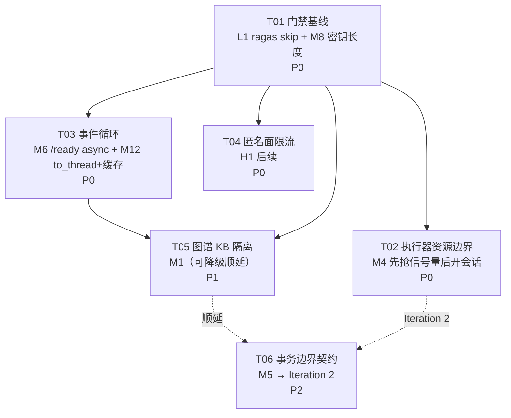

# Iteration 1 计划 — 检索基础稳定性收尾（审计遗留 P2）

**分支**：`dev/retrieval-foundation-qa-downstream`
**基线**：`ac24600b` + 工作区未提交改动（**以当前工作区代码为准**）
**计划日期**：2026-10-29
**上游输入**：`reports/audit-report-2026-10-23.md`、`reports/fix-report-2026-10-23.md`、`AGENTS.md`
**本报告性质**：只读分析产出的计划。未修改任何源码；所有代码证据均来自当前工作区（含未提交改动）。

---

## 0. 结论先行

| 判断 | 结论 |
|---|---|
| 审计结论总体可靠性 | **高**。8 项中 7 项在当前工作区仍成立，1 项（M6）的**具体失败模式**未能在本环境复现，需下调表述 |
| 最大新增发现 | M4 的严重度被**低估**：实测并发等待时连接占用数 = 等待任务数（6 个任务全持连接，池上限仅 15），而非"可能耗尽" |
| 第二发现 | M5 不是"要不要去 commit"，而是**同一层内有两套互斥契约**（`switch_active_generation` 只 flush 不 commit，同类的 `acquire` 却 commit），这比"隐式提交"更难排查 |
| Iteration 1 建议范围 | **5 个任务**：L1 + M8（门禁/配置）→ M4（执行器）→ M6 + M12（事件循环）→ 匿名限流 → M1（图谱隔离，可降级顺延） |
| 明确延后 | **M5**（事务边界）。理由见 §3 与 §4，改动面为 15 处源码调用点 + 5 个测试文件，且必须先定契约，不适合与限流/图谱隔离同迭代 |
| 规模红线 | 若迭代容量不足，**T05（M1）整块顺延**，T01–T04 构成"可交付的最小稳定迭代"，门禁仍闭合 |

---

## 1. 现状核实表

> 行号均为**当前工作区**（非 HEAD）行号。严重度沿用审计口径并给出修正说明。

| 项 | 当前代码证据（文件:行号） | 审计结论是否仍成立 | 严重度 |
|---|---|---|---|
| **M4** 执行器先开会话后抢信号量 | `services/lifecycle_task_executor.py:133` `async with self._session_factory() as session:` → `:138` `await task_repo.get(task_id)`（首条 SQL，检出连接）→ `:145` `async with self._semaphore, lock:`。连接在信号量等待期间**一直持有**。`_poll_once` 在 `:118` 以 `limit=1` 每 poll 抢一单、`:124` 立即 `create_task` | **成立，且比审计更严重**。实测（见下）：6 个并发等待者 → `pool.checkedout()==6`，而 `max_concurrency==2`。池为 `AsyncAdaptedQueuePool`，`pool_size=5`、`max_overflow=10`（实测），上限 15 | **P2→P1**（本地实测可达） |
| **M4b** `create_task` 句柄未跟踪 | `:124` `asyncio.create_task(self._execute_task(task.id))` 返回值被丢弃；`:55` `_active_tasks: set[str]` 只在协程**内部** `:131` 才加入 → 已创建未调度的任务不在 `_active_tasks` 中；`:88` `stop()` 只轮询 `_active_tasks`，从不 `cancel()` 这些任务 | **成立**。附带效果：孤儿任务异常无人检索（`Task exception was never retrieved`）；`stop()` 的后半段无 `await` 兜底 | P2 |
| **M4c**（新增发现）handler 异常可能让任务永久 `running` | `:147` `await session.commit()` 在 `try` 内、`:148` `except Exception` 在 `async with` **之外** → `_run_handler` 内 `:192-200` 若 `mark_retrying/mark_failed` 自身抛错，会话上下文退出即回滚，任务停留 `running`，只有下次进程启动的 `_recover_stale_tasks`（`:215`）才救回 | 审计未记录 | P2（新增） |
| **M5** repository 内部 `commit()` | `db/session.py:82-91`（`get_session` 在 yield 后 commit）；`kb_lease_repository.py:30,68,93,141,181`（5 处 commit）；`update_job_repository.py:145,210,248,317,375,431,465,511,595`（9 处）；`document_repository.py:139`（1 处）。**7 个 repo 零 commit**（`task_repository.py`、`knowledge_base_repository.py`、`answer_feedback_repository.py` 等） | **成立**，且形态更糟：`kb_lease_repository.py:184-262` `switch_active_generation()` **只 `flush()`（:261）不 commit**，与同类的 `acquire()`（:68 commit）契约相反。混用 `create`（flush 不 commit，`update_job_repository.py:28,96`）与 `claim_next`（commit，`:145`） | P2（正确性风险） |
| **M6** `/ready` 同步端点内 `asyncio.run()` | `api.py:957` `@application.get("/ready")` + `:958` `def ready(...)`（sync → 线程池执行）；`:981` `asyncio.run(_db_ok())`；`:999` `asyncio.run(_qdrant_ok())`；`:992` 每次探测新建 `AsyncQdrantClient` | **部分成立，表述需修正**。审计所述"典型报错 `attached to a different loop`"**在本环境未复现**：sqlite+aiosqlite 下连续 3 次探测均返回 `db:"ok"`（实测）。真实成立的是：①每次探测创建并销毁一个独立事件循环；②依赖 aiosqlite 跨 loop 可用的**实现细节**，而 `db/session.py:4` 明示未来切 PostgreSQL（asyncpg 连接严格绑定 loop）→ 迁移即炸；③Qdrant 客户端在一次性 loop 内创建/关闭，跨 loop 复用风险未验证；④无任何测试覆盖（`grep '/ready' tests/` 命中 0） | **P2 → P3**（潜在/可移植性），但修复成本极低，仍建议本迭代处理 |
| **M1** 图谱不按 KB 隔离 | `routers/graph.py:16` `APIRouter(prefix="/v1/graph")`（无 `kb_id`）；`:48-60` `_graph_path()` 全量依赖 `request.app.state.resolved_settings`；`:52-54` workspace 取自**应用级** `settings.qdrant_generation`。前端硬编码：`frontend/src/api/client.ts:128,132`、`frontend/src/views/GraphView.vue:7`。7 项测试全部按应用级 settings 构造：`tests/test_graph_api.py:22,53,68-74,102` | **成立**。补充两条审计未提的关键约束：①`/v1/graph/*` 是**匿名可达**（`api.py:578` `GET` + `_GRAPH_ROUTE_PREFIX`）→ 多 KB 场景下匿名者可遍历任一库图谱；②`graph/native` 走 `<iframe src>`（`GraphView.vue:7`），**iframe 无法携带 Authorization 头**，这直接限制了"改成需鉴权"的可行性 | P1（正确性 + 隐私） |
| **M12** 图布局 / fitz 同步阻塞 loop | 图：`routers/graph.py:77` `nx.spring_layout(...)` 位于 `async def graph_overview/graph_neighborhood/graph_native`（`:120,:126,:138`）内；`:66`→`graph_visualizer.py:66` `nx.read_graphml` 同步。PDF：`routers/documents.py:302,347` `_validate_page()`（内部 `:113` `fitz.open`）、`:326` `_page_context()`（内部 `:131` `fitz.open`）。**已修部分**：`:357` `await asyncio.to_thread(_single_page_pdf, ...)`（S1 附带收益，与 `fix-report` §三 一致） | **成立（部分已修）**。实测硬证据（本仓 `lightrag_storage/graph_chunk_entity_relation.graphml`，988 节点/1069 边）：`nx.read_graphml` **199.5 ms**，`spring_layout(150 节点)` **29.6–47.5 ms** → 单次 `/v1/graph/overview` 约 **230 ms 全阻塞事件循环**，且**无缓存**（每次重新解析 1.1 MB XML），且该路径**匿名可达** | P1（本地实测） |
| **M8** 无密钥最小长度校验 | `config.py:109-143` `__post_init__`：仅 `:110-115` 校验"两者不同"、`:116-119` 校验 staging+ "非空"。无长度下限。`scripts/check_env.ps1:22-23` 亦仅校验存在/不同 | **成立**。补充：`.env.local_staging:12` 的 `ADMIN_API_KEY` 为 6 字符（脱敏确认前缀 `123`），该文件**未被 git 跟踪**（`git ls-files` 无），但它被 `scripts/start_workbench.ps1:29` 加载 → **硬性 min_length=32 会直接打断演示启动流程** | P1（安全）但**必须带迁移** |
| **匿名查询限流** | 全仓入站限流搜索：`grep -rn "rate_limit\|RateLimit\|slowapi\|token_bucket\|throttle" src/` 仅命中 `lightrag_service.py:337`（字符串常量）与 `mineru_client.py:161,410`（MinerU **出站** 429），**入站零限流**。匿名面定义见 `api.py:530-586`：`GET /v1/knowledge-bases`、`POST /v1/feedback`（`:533`）、`GET /v1/graph/*`（`:578`）、`GET .../source(-file)`（`:580-585`）、`POST .../query`（`:586`）。匿名身份映射 `api.py:826-830`（`role="service"`, `credential_type="anonymous"`） | **成立**。补充：`ActorRole = Literal["service","admin"]`（`auth.py:14`）**仍无 `"anonymous"`**，`require_authenticated_actor`（`:63-67`）只做类型检查 → 匿名者在下游与真 service 不可区分（审计 H3 的次要建议未落地） | P1（公开面成本/可用性） |
| **L1** 未装 `ragas` 时 pytest 中断 | 链路：`tests/evaluation/test_ragas_migration.py:8` → `evaluation/ragas/conversation_adapter.py:11` `from ragas import Dataset`；另 `test_conversation_e2e_runner.py`、`test_conversation_e2e_semantic.py` 经 `evaluation.phase10.conversation_e2e_{runner,semantic}` 传递 | **成立**。实测（`.venv` 无 ragas）：`3 errors during collection` + `Interrupted: 3 errors during collection`，退出码非 0。门禁不一致：CI（`.github/workflows/quality.yml:28`）跑 `python -m pytest -q`（**无** `--ignore=tests/evaluation`），本地却必须加 `--ignore` 才能通过 | P3（但**污染整个门禁**，优先修） |

### 1.1 M4 的实测证据（复现脚本要点）

```
pool AsyncAdaptedQueuePool size=5 max_overflow=10   # 上限 15
复刻 _execute_task: 开会话 → SELECT → 抢 Semaphore(2)
6 个并发 worker →  "max concurrent checkedout while waiting = 6"
```

即：**只有 2 个任务真正在跑，却有 6 条连接被占住**。`_poll_once` 每 1 s 释放一个新任务（`:118` `limit=1` + `:111` `poll_interval=1.0`），而 handler（ingestion）耗时以分钟计 → **约 13 秒的突发即可把池抽干**，此后所有 API 的 DB 访问（含匿名查询）排队等待 30 s 后失败。

### 1.2 M12 的实测证据

```
nodes 988 edges 1069      # lightrag_storage/graph_chunk_entity_relation.graphml (1.1 MB)
read_graphml            199.5 ms
spring_layout(150)       47.5 ms / 29.6 ms
```

叠加：`_GRAPH_ROUTE_PREFIX` 匿名（`api.py:578`）+ 无缓存 → 一个匿名用户 5 req/s 即可让事件循环 100% 饱和。

---

## 2. Iteration 1 范围建议

### 2.1 必做（阻塞演示 / 安全红线）

| 项 | 纳入理由（取舍依据） |
|---|---|
| **L1** | 成本最低、收益最高：修复后本地门禁命令与 CI 完全一致（`pytest -q` 无 `--ignore`），后续所有任务的"确定性验证"才可信。这是**门禁前置条件**，必须先修，否则每个任务的验收都要打折扣 |
| **M8** | 安全红线（审计第 1 优先级遗留）。**但只能带迁移做**：`.env.local_staging` 6 字符密钥会被硬校验打断演示启动，因此策略必须是"staging+ 硬校验 / `local_dev` 仅告警" + 运维迁移说明 |
| **M4** | 从"潜在"升级为"实测可复现"的资源耗尽：演示中连续上传数份文档即可让整个 API 的 DB 访问卡死。改动集中单文件 3 个函数，性价比最高 |
| **M6 + M12** | 同一主题（"不要阻塞/污染事件循环"），合并为一个任务。M12 有 230 ms/请求的实测阻塞证据且接口匿名；M6 修复成本极低且顺手把 `/ready` 纳入测试覆盖（当前 0 覆盖） |
| **匿名限流** | 审计"三处真短板"之一（公开面无限流）。**关键可行性已验证**：限流只对 `credential_type == "anonymous"` 生效，而 `tests/conftest.py:13-16` 的 autouse fixture 让全部既有测试走 `local_development_actor()`（`api.py:824`，`credential_type="local_dev"`）→ **1290 项既有测试零影响**。这是本项能安全进入本迭代的决定性前提 |

### 2.2 可延后（Iteration 2）

| 项 | 延后理由 |
|---|---|
| **M1 图谱 KB 隔离** | 名义是"改路由"，实际是**跨栈改造**：后端路由 + `settings_for_knowledge_base` 接入 + 7 项 `test_graph_api.py` 全部重写（当前测试用应用级 `working_dir`，KB 化后必须在 DB 里种 KB 行）+ `test_public_route_contract.py` 4 处白名单断言 + 前端 3 个 API 方法 + `GraphView.vue` 新增 KB 选择器 + iframe 鉴权方案。**且存在产品决策**（见 §5 Q1）。若强行纳入，就必须挤掉限流 → 风险更高。<br>**降级选项**：若你判定必须本迭代做，则**移除 T04（限流）**，把 M1 作为 T04，其余顺序不变 |
| **M5 事务边界** | 改动面：`src/` 内 15 处调用点（`claim_specific` 2、`heartbeat_claim` 1、`save_checkpoint` 2、`mark_*_fenced` 4、`lease.acquire`/`heartbeat`/`release`/`update_generation_status`/`switch_active_generation` 共 6+）+ 5 个测试文件（`test_phase9b_job_recovery.py`、`test_phase15b_unified_document_lifecycle.py`、`test_phase15c_ac29/ac30`、`test_phase9b_multi_instance.py`）。<br>**硬阻塞**：`tests/test_phase9b_job_recovery.py:61-62` 在会话 A 内 `claim_next` 后，`:94` 用**另一个会话**读结果 → 现在靠 repo 内部 commit 才能通过。去掉 commit 必须**同时**改测试与调用方，属于破坏性契约变更，需先写"事务边界设计说明" |
| H5 剩余、M2、M3、M7、M9–M15、L2–L10 | 本轮既定范围外 |

### 2.3 规模核算

| 任务 | 源码文件 | 测试文件 | 前端 | 文档 |
|---|---|---|---|---|
| T01 | 1（`config.py`） | 2（改 3 + 新增 1） | — | 3 |
| T02 | 1（`lifecycle_task_executor.py`） | 1（新增） | — | — |
| T03 | 3（`api.py`, `routers/graph.py`, `routers/documents.py`） | 2（新增 1 + 增强 1） | — | — |
| T04 | 3（新增 `rate_limit.py`, `api.py`, `config.py`+`errors.py`） | 1（新增） | — | 1 |
| T05 | 1（`routers/graph.py`）+ `api.py` | 2（大改） | 3 | 1 |

合计约 **10 个源码文件 / 7 个测试文件 / 3 个前端文件**。在单个 Loop Engineering 迭代内（目标–验收–确定性验证–退出）可控。

---

## 3. 任务列表（按实现顺序）

> 顺序原则：先让门禁可信（T01）→ 再修单文件资源问题（T02）→ 再修事件循环（T03）→ 再叠加跨切面中间件（T04）→ 最后做跨栈改造（T05）。
> **冲突提示**：T03 / T04 / T05 都触碰 `api.py`，但行区间互不重叠（T03：`~957-1006`；T04：`~530-586` 常量区 + `~788-840` 中间件区；T05：`~530-586` 公开路由匹配器 + `~1357` 路由注册）。仍**必须串行执行**，每个任务单独 `git diff` 审查。

---

### T01 · 门禁基线：`pytest -q` 不再中断 + 密钥最小长度

**目标**
1. 未安装 `ragas` 时 `python -m pytest -q`（**无** `--ignore`）能完整跑完而非中断。
2. `SERVICE_API_KEY` / `ADMIN_API_KEY` 增加长度下限，且不打断本地演示。

**涉及文件**
- `tests/evaluation/test_ragas_migration.py`
- `tests/evaluation/test_conversation_e2e_runner.py`
- `tests/evaluation/test_conversation_e2e_semantic.py`
- `src/industrial_rag/config.py`
- `tests/test_config.py`
- `scripts/check_env.ps1`
- `.env.example`
- `docs/operations/security-audit.md`
- `README.md`

**依赖**：无（迭代起点）

**改动面（函数级）**
- 三个 `tests/evaluation/*` 文件：模块顶部、在 **任何** `evaluation.*` import **之前**插入 `pytest.importorskip("ragas", reason="optional dependency: pip install -e '.[dev,evaluation]'")`。不得改动测试逻辑（CI 装 `[dev,evaluation]`，行为不变）。
- `Settings.__post_init__`（`config.py:109`）：新增密钥长度校验分支。策略：
  - `deployment_environment ∈ {local_staging, staging, production}` 且 `len(key) < 32` → `ValueError`（文案须含变量名与最小长度）；
  - `local_dev` 且 `len(key) < 32` → `logger.warning`（不阻断，避免打断 20+ 处既有 `Settings(service_api_key="expected-key")` 构造）；
  - `None` 不参与长度校验（fail-closed 由 `api.py:816-825` 负责）。
- `scripts/check_env.ps1`：在既有 `SERVICE_API_KEY`/`ADMIN_API_KEY` 检查后追加 `Length -lt 32` 的 `$fail +=` 项与提示文案（复用 `:22-23,31-37` 现有结构）。
- `.env.example`：在 `:10-12` 注释中写明"≥32 字符，可用 `python -c "import secrets;print(secrets.token_urlsafe(32))"` 生成"。
- `docs/operations/security-audit.md` + `README.md`「Configure」段：新增迁移条目"已有部署需重新生成 ≥32 字符密钥；`.env.local_staging` 当前为 6 字符，升级后 `local_staging` 将拒绝启动"。

**验收标准（确定性证据）**
1. `python -m pytest -q 2>&1 | tail -1` 输出形如 `NNN passed, MM skipped`，**不含** `Interrupted` / `error`；退出码 0。（当前实测：`Interrupted: 3 errors during collection`）
2. `python -m pytest -q tests/evaluation -k ragas` 显示 `skipped`，不显示 `error`。
3. 新增并通过：`tests/test_config.py::test_staging_rejects_short_service_api_key`、`::test_production_rejects_short_admin_api_key`、`::test_local_dev_short_key_only_warns`、`::test_length_check_ignores_absent_key`。
4. `python -m ruff check .` → `All checks passed`。
5. `python scripts/check_public_repo.py` → PASS。

**优先级**：P0

---

### T02 · 执行器资源边界：先抢信号量后开会话 + 跟踪任务句柄

**目标**
1. 等待信号量期间**不持有** DB 连接（连接占用数 ≤ `max_concurrency`）。
2. `create_task` 句柄被跟踪、`stop()` 可取消并等待、异常不被吞。
3. handler 异常路径下任务不会永久停留 `running`。

**涉及文件**
- `src/industrial_rag/services/lifecycle_task_executor.py`
- `tests/test_task_executor_concurrency.py`（新增）

**依赖**：T01（门禁可信后才能把"新增测试通过"当证据）

**改动面（函数级）**
- `__init__`：新增 `self._task_handles: set[asyncio.Task[None]]`；`_semaphore` 保持不变。
- `_poll_once`：`create_task` 结果保存到 `_task_handles`，并 `add_done_callback` 移除句柄 + 检索异常（`task.exception()` 记日志），避免 `Task exception was never retrieved`。
- `_execute_task`：**重排为两段会话**——
  1. 短会话：只读 `(task_id, knowledge_base_id)`，随后关闭（不持连接）；
  2. `async with self._semaphore, lock:` **之后再**开第二个会话并 `task_repo.get()` 重新加载 `task`，再调用 `_run_handler` + `commit()`。
  注意：`task.attempt` 已由 `_poll_once` 的 `mark_running` 自增并提交（`:120`+`:123`），重新加载后字段一致；不得在多处复用同一 ORM 实例跨会话。
- `_execute_task` 的异常处理：把 `except Exception` **移入**会话上下文内部（或显式 `rollback` 后用新会话写 `mark_failed`），确保 handler 异常时任务落到 `retrying`/`failed` 而非停在 `running`。
- `stop()`：先 `cancel()` 全部 `_task_handles`，再 `await asyncio.gather(*handles, return_exceptions=True)`（受 `shutdown_timeout` 约束），最后再按 `_active_tasks` 兜底；顺手把 `:87-88` 的 `asyncio.get_event_loop().time()` 换为 `asyncio.get_running_loop().time()`（L5，零风险顺手清）。

**验收标准（确定性证据）**
1. 新增并通过：`tests/test_task_executor_concurrency.py::test_semaphore_wait_does_not_hold_db_connection` —— 断言"等待期间 `engine.pool.checkedout() <= max_concurrency`"。（改前用同一断言跑会得到 `6 > 2`，即该测试在旧实现上必然失败——先在旧代码上跑一次留下失败记录，作为"修复前证据"）
2. 新增并通过：`::test_task_handles_are_tracked_and_drained_on_stop` —— `stop()` 后 `executor._task_handles == set()` 且 `_active_tasks == set()`。
3. 新增并通过：`::test_handler_exception_commits_retrying_not_running` —— handler 抛异常后，用**新会话**读该任务，`status == retrying`（attemp < max）。
4. 回归：`python -m pytest -q tests/test_lifecycle_restart_recovery.py tests/test_ingestion_task_chaining.py` 全绿（现仅 `test_lifecycle_restart_recovery.py:38` 直接引用执行器，影响面小）。

**优先级**：P0

---

### T03 · 事件循环：`/ready` 改 async + 图谱/PDF 解析移出 loop

**目标**
1. `/ready` 不再创建一次性事件循环，且探测有超时、有缓存。
2. 图谱加载/布局/渲染与 PDF 页读取不再阻塞事件循环。

**涉及文件**
- `src/industrial_rag/api.py`
- `src/industrial_rag/routers/graph.py`
- `src/industrial_rag/routers/documents.py`
- `tests/test_ready_probe.py`（新增）
- `tests/test_graph_threading.py`（新增）
- `tests/test_document_source_api.py`（增强）

**依赖**：T01

**改动面（函数级）**
- `api.py`：
  - 提取 `async def _db_reachable() -> bool`，供 `/healthz`（`:906`）与 `/ready` 共用（消除重复 `async for _ in get_session(): break`）。
  - `/ready`（`:958`）改为 `async def`；DB 探测 `async with asyncio.timeout(2.0)`；Qdrant 探测同样加超时，并在 `app.state` 上做 **TTL 缓存**（建议 5 s，键含 `backend/generation`），避免高频探针每次都新建 `AsyncQdrantClient`（`:991-998`）。
  - **必须同时加超时**：原实现阻塞在线程池线程里，改 async 后 DB 卡住会直接阻塞主 loop —— 这是"修 M6 引入新风险"的点，不做超时不得合并。
- `graph.py`：
  - `_load_graph` / `_serialize_graph` / `render_pyvis_html` 的 CPU 部分整体 `await asyncio.to_thread(...)`；
  - 新增按 `(path, st_mtime_ns, st_size)` 的**图缓存**（模块级 dict + 上限，避免 199 ms/请求的重复 `read_graphml`）；
  - `spring_layout` 结果可按 `(path 指纹, limit, hops, seed)` 缓存。
- `documents.py`：
  - `_validate_page`（`:104`）→ `async def` 包装，`_page_context`（`:124`）→ 内部 `fitz` 调用 `await asyncio.to_thread(...)`；
  - 同步改两处调用点 `:302,:347` 与 `:326`（`_page_context` 现在须 `await`）。已确认**无测试直接调用**这两个内部函数（`grep _validate_page tests/` 仅命中 `test_phase10b_failure_matrix.py:162` 的同名字符串常量），可安全改变签名。

**验收标准（确定性证据）**
1. 新增并通过：`tests/test_ready_probe.py::test_ready_endpoint_is_async` —— `inspect.iscoroutinefunction(app.routes['/ready'].endpoint)` 为真。
2. 新增并通过：`::test_ready_source_has_no_asyncio_run` —— `"asyncio.run" not in inspect.getsource(ready_endpoint)`。
3. 新增并通过：`::test_ready_reports_db_ok_under_lifespan`（200 且 `components.db == "ok"`）、`::test_ready_reports_503_when_db_probe_fails`（patch 使探测抛错 → 503 + `status=="not_ready"`）、`::test_ready_db_probe_times_out`（patch 为 `asyncio.sleep(10)` → 在 <3 s 内返回，`components.db != "ok"`）。
4. 新增并通过：`tests/test_graph_threading.py::test_spring_layout_runs_off_event_loop_thread` —— monkeypatch `nx.spring_layout` 记录 `threading.current_thread()`，断言与主 loop 线程不同。
5. 新增并通过：`::test_graphml_is_parsed_once_for_repeated_requests` —— monkeypatch `nx.read_graphml` 计数，连续 2 次 `/v1/graph/overview` 后计数为 1。
6. 增强并通过：`tests/test_document_source_api.py::test_page_context_reads_pdf_off_event_loop_thread`。
7. 回归：`tests/test_graph_api.py`（7 项）、`tests/test_graph_visualizer.py`、`tests/test_document_source_api.py` 全绿。

**优先级**：P0

---

### T04 · 匿名面限流

**目标**
`credential_type == "anonymous"` 的请求按客户端 IP 限流，超限返回 429；Bearer 与本地开发身份不受影响。

**涉及文件**
- `src/industrial_rag/rate_limit.py`（新增）
- `src/industrial_rag/api.py`
- `src/industrial_rag/config.py`
- `src/industrial_rag/errors.py`
- `tests/test_anonymous_rate_limit.py`（新增）
- `docs/operations/security-audit.md`（补配置说明）

**依赖**：T01；建议在 T03 之后（同文件 `api.py`，串行）

**改动面（函数级）**
- 新模块 `rate_limit.py`：`class AnonymousRateLimiter`（滑动/固定窗口 + `monotonic()`，`dict[key, deque[float]]`，带 LRU 上限防内存膨胀），方法 `allow(key) -> bool` / `retry_after(key) -> int` / `reset()`。**实例挂在 `app.state`（非模块级单例）**，保证每个测试客户端独立计数，避免跨测试串扰。
- `api.py`：
  - `create_app` 内按 `Settings` 构造 limiter 挂到 `application.state`；
  - 在**匿名分支内部**（`api.py:826-830`，即 `credential_type="anonymous"` 赋值处之后、`call_next` 之前）插入限流判定。位置理由：此处的 `tests/conftest.py` 路径（`:824` `local_development_actor()`）**先行返回**，因此 1290 项既有测试完全不进入限流逻辑（已验证该分支顺序）；
  - 健康路径 `_HEALTH_PATHS`（`:814`）已在最前，探针不受限流；
  - 超限时 `operational_metrics.increment("rate_limited_total")` + 返回 429，响应头带 `Retry-After`；
  - 客户端 key：默认 `request.client.host`；`IRA_TRUST_PROXY_HEADERS=1` 时才读 `X-Forwarded-For` 首段（默认关，防伪造）。
- `errors.py`：新增 `AppErrorCode.rate_limited = "RATE_LIMITED"` + `HTTP_STATUS_MAP[...] = 429`。
- `config.py`：新增 `public_rate_limit_per_minute: int`（`from_mapping` 读 `IRA_PUBLIC_RATE_LIMIT_PER_MINUTE`，`__post_init__` 校验 `>= 0`；`0` = 关闭）。**默认值待你拍板**（§5 Q2，建议 30）。

**验收标准（确定性证据）**
1. 新增并通过：`tests/test_anonymous_rate_limit.py::test_anonymous_query_returns_429_after_budget` —— 第 N+1 次 `POST /v1/knowledge-bases/kb/query` 返回 429、`code == "RATE_LIMITED"`、含 `Retry-After` 头。
2. `::test_bearer_requests_are_not_limited` —— 带 `Authorization: Bearer <admin>` 的请求在限额内/外均非 429。
3. `::test_local_dev_insecure_actor_is_not_limited` —— 保持 `IRA_DEV_INSECURE=1` 时大量请求均非 429（**这条就是"1290 项测试不受影响"的证明**）。
4. `::test_limit_disabled_when_config_is_zero`。
5. `::test_window_expiry_restores_access`（用可注入时钟/`monotonic` patch，不 `sleep`）。
6. `::test_distinct_client_ips_have_independent_budgets`。
7. `/metrics` 快照含 `rate_limited_total`。
8. 回归：`python -m pytest -q tests/test_public_route_contract.py` 全绿（该文件大量匿名请求，用于验证 limiter 不会误伤）。

**优先级**：P0

---

### T05 · 图谱按 KB 隔离（**可降级顺延项**）

**目标**
图谱接口从"应用级 settings"改为"按 `kb_id` 派生的受信 KB settings"，消除跨 KB 泄漏。

**涉及文件**
- `src/industrial_rag/routers/graph.py`
- `src/industrial_rag/api.py`（公开路由匹配器 + 路由注册）
- `tests/test_graph_api.py`（大改）
- `tests/test_public_route_contract.py`
- `frontend/src/api/client.ts`
- `frontend/src/views/GraphView.vue`
- `frontend/src/components/graph/graph-view.test.ts`
- `docs/architecture-audit.md` 或 `docs/operations/security-audit.md`

**依赖**：T01、T03（同文件重构先后关系）

**改动面（函数级）**
- `graph.py`：`APIRouter(prefix="/v1/knowledge-bases/{kb_id}/graph")`；`_graph_path` 改为 `async def`，注入 `AsyncSession`，取 `KnowledgeBaseRepository.get(kb_id)` → `settings_for_knowledge_base(base_settings, kb)`（`kb_runtime_settings.py:13`）→ 用派生后的 `working_dir` + `vector_workspace` 调 `graph_tools.locate_graph_file`；KB 不存在 → 404 `knowledge_base_not_found`；删除 `:53-57` 的 `settings.qdrant_generation` 兜底。
- `api.py`：`_is_public_browser_request`（`:562`）把 `_GRAPH_ROUTE_PREFIX`（`:540`, `:578`）替换为结构化匹配 `_is_public_kb_graph_path`（`/{kb_id}/graph/{overview|neighborhood|native}`，显式三段枚举，**不**用 `startswith`）。
- 旧 `/v1/graph/*`：返回 404 + `code="GRAPH_ROUTE_MOVED"`（显式表），**不保留**应用级兜底（保留即等于保留泄漏）。
- 前端：`client.ts:128,132` 增加 `kbId` 形参；`GraphView.vue:7` 的 `nativeGraphUrl` 改为带 `kbId`，并新增 KB 选择器（复用 `ApiClient.listKnowledgeBases()`，`client.ts:39`）。

**验收标准（确定性证据）**
1. 新增并通过：`tests/test_graph_api.py::test_graph_is_isolated_between_knowledge_bases` —— 种两个 KB、各写一份不同节点集的 graphml，断言 A 的响应只含 A 的节点（**这是本任务的核心证据**）。
2. `tests/test_graph_api.py` 其余 6 项改写为 KB 路径后全绿。
3. 新增并通过：`::test_legacy_graph_route_is_gone` —— `GET /v1/graph/overview` → 404 且 `code == "GRAPH_ROUTE_MOVED"`。
4. `tests/test_public_route_contract.py`：白名单断言更新为新路径；新增"`/v1/knowledge-bases//graph/overview`（空 kb_id）不被判为公开"。
5. 前端：`npm run test -- --run` 全绿（含更新后的 `graph-view.test.ts`）；`npm run build` 成功。
6. `python -m ruff check .` → 通过。

**优先级**：P1（本迭代**可整块顺延**至 Iteration 2）

---

## 4. 风险与回滚

### 4.1 会影响既有 1290 项测试语义的点

| 风险点 | 具体机制（已验证） | 缓解 / 回滚 |
|---|---|---|
| **`tests/conftest.py` autouse fixture** | `:13-16` 强制 `IRA_DEV_INSECURE=1` + `IRA_DEPLOYMENT_ENVIRONMENT=local_dev` → 所有请求走 `api.py:824` `local_development_actor()`（`credential_type="local_dev"`） | **T04 的唯一红线**：限流判定必须放在 `:826` 之后，仅匹配 `credential_type=="anonymous"`。若误放在 `:816` 之前或按"无 Authorization 头"判定，将命中全部 1290 项 |
| **认证 fail-closed 行为矩阵**（fix-report §五） | 三档：`local_dev`+开关 / `local_dev`无开关 / `staging|production` | T04 不得改动 `:814-830` 的顺序：健康路径 → fail-closed 分支 → 匿名分支 → Bearer。T05 若把图谱改为**需鉴权**（见 §5 Q1），会新增第 4 档行为，必须同步更新 `tests/test_public_route_contract.py:100-170` 的矩阵测试 |
| **M8 长度校验 vs 既有测试** | 20+ 处直接构造短密钥：`test_api.py:61,197-226,277`（`"expected-key"` 11 字符）、`test_graph_api.py:91`（`"service-secret"`）、`test_public_route_contract.py:88-89,165-166`、`test_config.py:21`（`"local-key"` 9 字符）、`test_phase9b_multi_instance.py:518` 等 | 校验**仅**对 `{local_staging, staging, production}` 硬失败。`local_dev`（测试默认）只警告。回归用 `pytest -q` 全量作为验收证据 |
| **M8 打断演示启动** | `.env.local_staging:12` `ADMIN_API_KEY` 为 6 字符，被 `scripts/start_workbench.ps1:29` 加载；该文件**未入库**（gitignore `.env.*`） | 必须随任务交付"运维迁移条目"；上线前由你本地重新生成密钥。回滚：把 staging 分支校验降级为 `warning`（单点改动） |
| **T03 `/ready` sync→async 的语义反转** | 原实现阻塞线程池线程（不阻塞 loop）；改 async 后 DB/Qdrant 卡住会直接阻塞主 loop | 验收里强制"必须带 `asyncio.timeout(2.0)`"与超时测试；这是一条**合入门槛**，不是可选项 |
| **T03 图谱缓存引入陈旧数据** | 缓存键用 `(path, st_mtime_ns, st_size)` | 验收含"不同 mtime 必须重新解析"（隐式由隔离测试覆盖）。回滚：缓存可整体关掉（保留 `to_thread` 仍解决阻塞） |
| **T02 会话重排导致 detached 实例** | `task` 由会话 A 读取、会话 B 使用会触发 `DetachedInstanceError` | 设计已规避（抢到信号量后**重新加载** task）；验收 `test_handler_exception_commits_retrying_not_running` 用新会话复核状态 |
| **T02 改变"抢占即 running"时序** | `mark_running` 仍在 `_poll_once`（`:120-123`）提交，未移动 → `running` 语义不变 | 但若有外部逻辑依赖"进入 `_execute_task` 即 running"，需在评审时确认（当前 `grep` 无此类依赖） |
| **T05 破坏 `/v1/graph/*`** | 前端 `client.ts:128,132`、`GraphView.vue:7`、`graph-view.test.ts:23`；后端测试 7 项 + 公开契约 4 处 | 前后端必须在**同一 commit** 内切换；回滚策略是"保留旧路由别名 + 明确 deprecation 日期"——但那等于承认泄漏仍在，故**不推荐**；若必须回滚，整块 revert T05 |
| **未提交改动污染 diff（L10）** | 当前 47 个已改 + 20+ 未跟踪文件（实测 `git status`） | **强烈建议在 T01 开工前做一次基线提交**，否则每个任务的"改动面"无法用 `git diff` 自证，Loop Engineering 的"确定性证据"前提不成立 |

### 4.2 需要迁移或兼容层的项

| 项 | 迁移/兼容需求 |
|---|---|
| M8 | **配置迁移**：`local_staging`/`staging`/`production` 部署需重新生成 ≥32 字符密钥；`.env.example` 与 `docs/operations/security-audit.md` 必须写明生成命令。**无数据迁移** |
| M1 | **路由迁移（破坏性）**：`/v1/graph/*` → `/v1/knowledge-bases/{kb_id}/graph/*`，前后端同 commit；**无数据迁移**（图谱文件路径本就由 KB 元数据派生，`vector_workspace` 已存在） |
| 限流 | **配置新增**：`IRA_PUBLIC_RATE_LIMIT_PER_MINUTE`；默认值决定"上线即生效"与否（§5 Q2）。无迁移 |
| M4 | **无迁移**。但注意：升级瞬间若有任务停留在 `running`，`_recover_stale_tasks`（`:215`）会按原逻辑恢复，行为不变 |
| M5（延后） | 若 Iteration 2 执行，需 **兼容层**：`UpdateJobRepository` 保留 `commit` 关键字（默认 `True`）逐步切到 `False`，否则一次性改完无法分批验证 |

---

## 5. 待澄清事项（需你/产品拍板）

| # | 决策点 | 背景与影响 | 我的建议 |
|---|---|---|---|
| **Q1** | **图谱路由迁移是否可接受破坏 `/v1/graph/*`？** 更深一层：图谱是否需要鉴权？ | `graph/native` 通过 `<iframe src>` 加载（`GraphView.vue:7`），**iframe 无法携带 `Authorization` 头**。因此"图谱改成需鉴权"有 3 条路：(a) 保持匿名 + 限流；(b) 新增受保护的 `graph/native-url` 签发短时签名 URL，iframe 用签名 URL 加载；(c) 放弃 iframe，改前端渲染。另：GraphView **不在** `docs/demo/demo-script.md` 的演示路径上（Scene A/B/C 均不涉及图谱），所以"为演示保留匿名"的论证不成立 | 倾向 **(a)**：本迭代保持匿名 + 由 T04 限流覆盖，代价最小、演示无影响；把 (b) 记入 Iteration 2。**但这需要你确认**——若你希望图谱对外"看起来"也是受控资源，(b) 会让 T05 明显变大 |
| **Q2** | **匿名限流阈值取多少？按什么维度？默认开启还是仅 staging+？** | README 记录查询 P95 为 5.861 s；演示中一次 QA 交互可能连发 1–3 个请求。按 IP 单桶 vs 按 `IP+KB` vs 按 `IP+路径类`（query / feedback 分开） | 建议：**30 req/min/IP**（匿名总量），`POST /v1/feedback` 单独收紧到 **5 req/min/IP**（对应 M3 反馈污染面）；`IRA_PUBLIC_RATE_LIMIT_PER_MINUTE` 默认 **30**（即默认生效）。若你担心本地脚本被误伤，可将默认改为 `0`（关闭）并要求 staging+ 显式开启——但那样"公开面无限流"的风险在默认部署下仍在 |
| **Q3** | **是否信任 `X-Forwarded-For`？** | 若前面有反向代理（`docs/operations/deployment.md`），不看 XFF 会把所有匿名用户当成同一个 IP（等于全局 30/min，演示会自己把自己限流）。若无条件信任 XFF，攻击者可伪造头绕过 | 建议：新增 `IRA_TRUST_PROXY_HEADERS`（默认 `false`），部署到反代后再打开，并在 `docs/operations/deployment.md` 注明"必须由反代覆写 XFF" |
| **Q4** | **M8 的最小长度策略是否接受"staging+ 强制 / local_dev 仅告警"？** | 若你对所有环境强制 32，需同时改 20+ 处测试构造与 `.env.local_staging`，T01 从"小任务"变成"中任务" | 建议接受分层策略；真正要防的是"把弱密钥带到可对外访问的部署" |
| **Q5** | **M5（事务边界）是否确认延后到 Iteration 2？** 若要现在做，是否接受"repository 不再 commit、调用方显式 commit"的破坏性契约（5 个测试文件需同步改）？ | `tests/test_phase9b_job_recovery.py:61-62` + `:94` 的跨会话读取依赖 repo 内部 commit；一次性改完会让本迭代的"确定性验证"混入大量契约改写噪声 | 建议延后，并先产出一页《事务边界契约》（谁开事务、谁提交、fenced 写是否允许自动提交），再动代码 |
| **Q6** | **`/ready` 的探测超时与缓存 TTL？** | 改 async 后必须超时，否则 DB 抖动会阻塞整个 loop；但超时过短会把"慢"误报成"未就绪" | 建议 DB 2 s、Qdrant 2 s、结果缓存 5 s。若你的探针周期是 1 s，缓存 5 s 可把 DB/Qdrant 压力降到 1/5 |
| **Q7** | **是否同意"先在 T01 前做一次基线提交"（清 L10）？** | 当前 47 改 + 20+ 未跟踪；不提交则任何任务的 `git diff` 都无法证明"只改了这些" | 强烈建议同意。这是 `AGENTS.md` 中"Completion requires deterministic evidence such as ... Git diffs"的前提 |

---

## 6. 任务依赖图



> 依赖说明：T02/T03/T04 之间**无**硬依赖，可并行开发；但因 T03/T04/T05 均改 `api.py`，**合并顺序必须是 T03 → T04 → T05**。

---

## 7. 迭代退出条件（对齐 `AGENTS.md` 的确定性验证）

Iteration 1 判 `SUCCESS` 需同时满足：

1. `python -m pytest -q`（**无** `--ignore`）→ 全部通过 / 跳过，**零 collection error**，退出码 0；且总量 ≥ 1290 + 本迭代新增。
2. `python -m ruff check .` → `All checks passed`。
3. `python scripts/check_public_repo.py` → PASS。
4. `cd frontend && npm run test -- --run && npm run build` → 通过（仅在 T05 纳入时必需）。
5. 上表每个任务的"验收标准"逐条有可复现输出（测试名 + 断言），并保留"修复前失败"记录（至少 T02、T12 各一条）。
6. 每个任务的 `git diff` 独立可审（前提：Q7 的基线提交已完成）。

判 `BLOCKED` 的条件：Q1 / Q2 未拍板导致 T04 或 T05 无法定稿。
判 `PHASE_BOUNDARY` 的条件：T01–T04 完成而 T05 顺延 —— 此时按"最小稳定迭代"收口，不自动进入 Iteration 2。

---

## 附录 A · 本轮核实使用的方法（可复现）

| 核实项 | 方法 |
|---|---|
| M4 连接占用 | 用 `get_session_factory()` 复刻 `_execute_task` 顺序（开会话 → SELECT → `Semaphore(2)`），6 worker，打印 `engine.pool.checkedout()` 峰值 = 6；`pool.size()==5`、`_max_overflow==10` |
| M12 阻塞量级 | 直接对 `lightrag_storage/graph_chunk_entity_relation.graphml` 计时：`read_graphml` 199.5 ms、`spring_layout(150)` 29.6–47.5 ms |
| M6 是否复现跨 loop 报错 | `TestClient(create_app(...))` 下连续 3 次 `GET /ready`，均 200 且 `components.db=="ok"` → **未复现**审计所述报错；据此下调 M6 表述 |
| L1 中断 | `.venv/Scripts/python.exe -m pytest tests/evaluation --collect-only -q` → `3 errors` + `Interrupted` |
| 限流零影响论证 | 读 `tests/conftest.py:13-16` + `api.py:816-830` 分支顺序：`IRA_DEV_INSECURE=1` 路径在匿名分支**之前**返回 |
| M5 调用面 | `grep -c "\.commit()" repositories/*.py`（`kb_lease`=5、`update_job`=9、`document`=1，其余 0）；`grep` 统计 src 内非 repo 调用点 ≈15 处 |
| M8 爆炸半径 | `grep -rn "SERVICE_API_KEY\|ADMIN_API_KEY\|service_api_key=\|admin_api_key=" tests/` → 20+ 处短密钥构造 |
| 未跑全量 pytest | 遵守分工，仅做 `--collect-only` 与定向探针，未执行 1290 项全量 |
